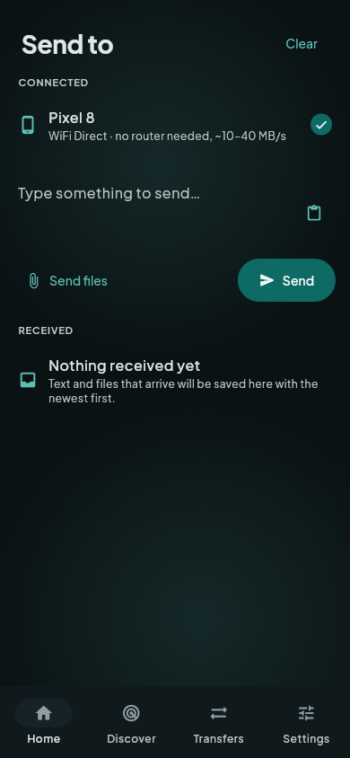
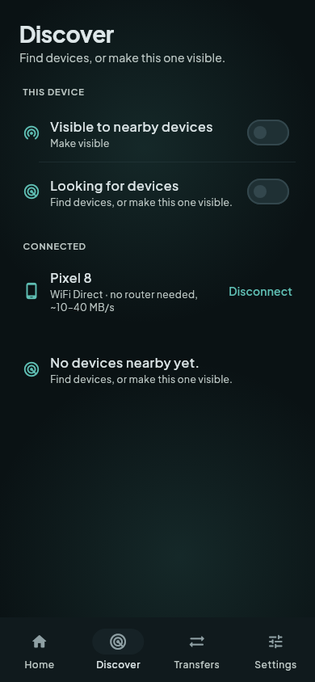
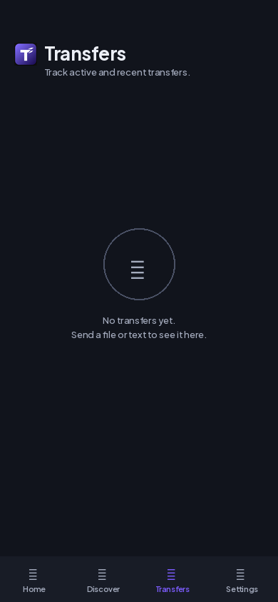
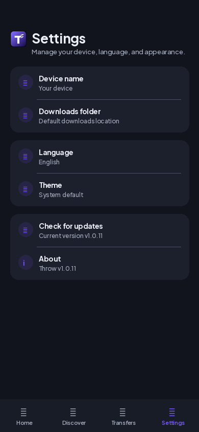
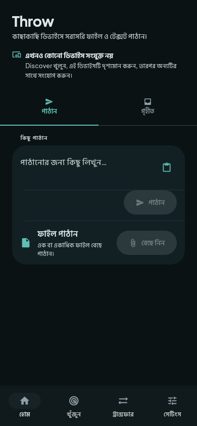

<div align="center">


# Throw

**Throw anything to anyone nearby.**

[](https://github.com/mahimmazidul/throw/releases/latest)
[](https://github.com/mahimmazidul/throw/actions/workflows/ci.yml)
[](https://github.com/mahimmazidul/throw/actions/workflows/cd.yml)
[](LICENSE)
[](https://github.com/mahimmazidul/throw)

</div>

## What is Throw?

Throw is a local file and text sharing app for Android, Windows, and Linux. It connects nearby devices directly over WiFi Direct (Android) and Bluetooth, so you can send files, text, and shared items quickly from one device to another.

## Features

- **Direct local sharing** — send files and text between nearby devices over WiFi Direct and Bluetooth.
- **Multiple files** — pick multiple files at once, or share them into Throw from the Android share sheet.
- **Text & clipboard** — paste or type text and send it instantly.
- **Cross-platform** — Android, Windows, and Linux builds.
- **Transfer progress** — track active and recent transfers.
- **Received items** — everything that arrives is kept, newest first: copy text with one tap, open or save files.
- **Update checker** — check for the latest GitHub release from Settings.
- **Bilingual UI** — English and বাংলা, with a bundled Bengali typeface so Bangla renders on Windows and Linux too.
- **Remembers your setup** — device name, language and theme survive a relaunch.
- **Modern, dark-first design** — clean interface with Plus Jakarta Sans typography.

## How it works

1. Open Throw on both devices.
2. Make a device visible and discover nearby devices.
3. Connect, pick files or text, and send.

## Download

Get the latest build from [GitHub Releases](https://github.com/mahimmazidul/throw/releases/latest).

| Platform | Formats |
|---|---|
| Android | APK (ARM64/ARM32/x86_64), AAB |
| Windows | ZIP, MSIX |
| Linux | .deb, AppImage, tar.gz |

## Screenshots

<p align="center">
  
  
  
  
  
</p>

Screenshots are rendered by `test/screenshots_test.dart` with the bundled fonts
and compared in CI, so they cannot drift from the app again. Regenerate with:

```bash
flutter test --update-goldens \
  --dart-define=THROW_COMPARE_SCREENSHOTS=true test/screenshots_test.dart
```

## Tech stack

| Layer | Choice |
|---|---|
| Framework | Flutter 3.x (Dart >=3.0.0 <4.0.0) |
| Android transfer | `nearby_connections` (WiFi Direct / Nearby) |
| Desktop transfer | `bluetooth_low_energy` |
| State management | `provider` |
| Persistence | `shared_preferences` |
| UI | Material 3, Plus Jakarta Sans + Hind Siliguri, responsive layout |
| Localization | `flutter_localizations` + `intl` (en, bn) |

## Build locally

```bash
git clone https://github.com/mahimmazidul/throw.git
cd throw
flutter pub get
flutter gen-l10n
flutter run
```

## Design notes

The UI pass behind v1.1 is documented in [docs/UI-AUDIT.md](docs/UI-AUDIT.md):
what was compared (LocalSend, Bloomee, Musify, Planets), every defect found,
and the test that now guards each one.

## Contributing

Issues and PRs are welcome — see [CONTRIBUTING.md](CONTRIBUTING.md).

## License

MIT — see [LICENSE](LICENSE).
