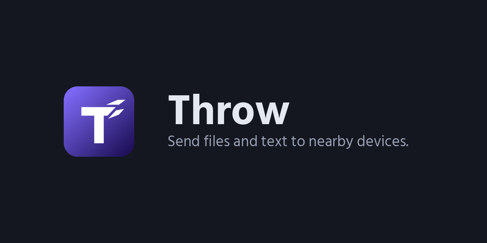

<div align="center">


# Throw

**Throw anything to anyone nearby.**

[](https://github.com/mahimmazidul/throw/releases/latest)
[](https://github.com/mahimmazidul/throw/actions/workflows/ci.yml)
[](https://github.com/mahimmazidul/throw/actions/workflows/cd.yml)
[](https://codecov.io/gh/mahimmazidul/throw)
[](LICENSE)
[](https://github.com/mahimmazidul/throw)
[](https://flutter.dev)

</div>

## What is Throw?

Throw is an offline file and text sharing app for Android, Windows, and Linux.
Files move directly between devices over WiFi Direct (Android↔Android) or Bluetooth (desktop). The transfer never passes through a server.
It is open source under the MIT license.

## Features

- Discover nearby devices automatically
- WiFi Direct between Android devices (~250 Mbps)
- Bluetooth for desktop and cross-platform transfers (~3 Mbps)
- Fully offline transfers — a router is never involved
- Send any file, or plain text
- Clipboard sync — copy on one device, paste on the other
- Real-time transfer progress with accept/reject bottom sheet
- Responsive layout: phone, tablet, foldable, desktop window
- English and বাংলা (Bengali)
- Dark mode first

## How it works

```
  ┌─────────────┐     ┌──────────────────┐     ┌─────────────┐
  │  Open Throw  │ ──► │ Discover nearby  │ ──► │ Tap to send │
  └─────────────┘     └──────────────────┘     └─────────────┘
        1                     2                       3
```

Both devices run Throw. They find each other over BLE/WiFi Direct/Bluetooth,
you pick the files, and the bytes move device-to-device. Nothing touches a server.

## Download

Every [`v*.*.*`](https://github.com/mahimmazidul/throw/releases) tag builds all platforms:

| Platform | Format | Link |
| --- | --- | --- |
| Android ARM64 | APK | [Latest Release](https://github.com/mahimmazidul/throw/releases/latest) |
| Android ARM32 | APK | [Latest Release](https://github.com/mahimmazidul/throw/releases/latest) |
| Android | AAB | Play Store (soon) |
| Windows | MSIX | [Latest Release](https://github.com/mahimmazidul/throw/releases/latest) |
| Windows | ZIP | [Latest Release](https://github.com/mahimmazidul/throw/releases/latest) |
| Linux (Debian/Ubuntu) | .deb | [Latest Release](https://github.com/mahimmazidul/throw/releases/latest) |
| Linux (universal) | tar.gz | [Latest Release](https://github.com/mahimmazidul/throw/releases/latest) |
| Linux | AppImage | [Latest Release](https://github.com/mahimmazidul/throw/releases/latest) |

## Screenshots



## Tech stack

| Layer | Choice |
| --- | --- |
| Framework | Flutter 3.x (stable), Dart >=3.0.0 <4.0.0 |
| Android transfer | `nearby_connections` (WiFi Direct) |
| Desktop transfer | `bluetooth_low_energy` (Bluetooth) |
| State management | `provider` |
| UI | Material 3, `flutter_animate`, `lottie`, `skeletonizer`, `flutter_slidable` |
| Typography | Hind Siliguri (`google_fonts`) |
| Responsive | `flutter_adaptive_scaffold`, breakpoints in `core/breakpoints.dart` |
| Desktop window | `window_manager`, `flutter_window_close` |
| Localization | `flutter_localizations` + `intl` (en, bn) |
| Packaging | `flutter_launcher_icons`, `flutter_native_splash`, `msix` |

## Build locally

```bash
git clone https://github.com/mahimmazidul/throw.git
cd throw
flutter pub get
flutter gen-l10n
flutter run
```

## Project structure

```
throw/
├── .github/
├── docs/
├── android/
├── lib/
│   ├── main.dart
│   ├── app.dart
│   ├── core/
│   ├── l10n/
│   ├── models/
│   ├── services/
│   ├── providers/
│   ├── screens/
│   └── widgets/
├── test/
├── assets/
├── pubspec.yaml
├── l10n.yaml
└── analysis_options.yaml
```

## Contributing

Issues and PRs are welcome — see [CONTRIBUTING.md](CONTRIBUTING.md).

## License

MIT — see [LICENSE](LICENSE). Free forever.

## Acknowledgements

- [Google Nearby Connections API](https://developers.google.com/nearby)
- [Flutter](https://flutter.dev)
